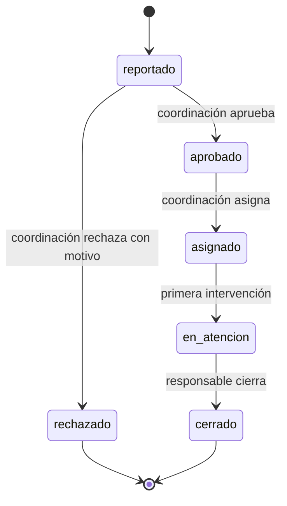
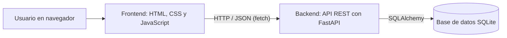
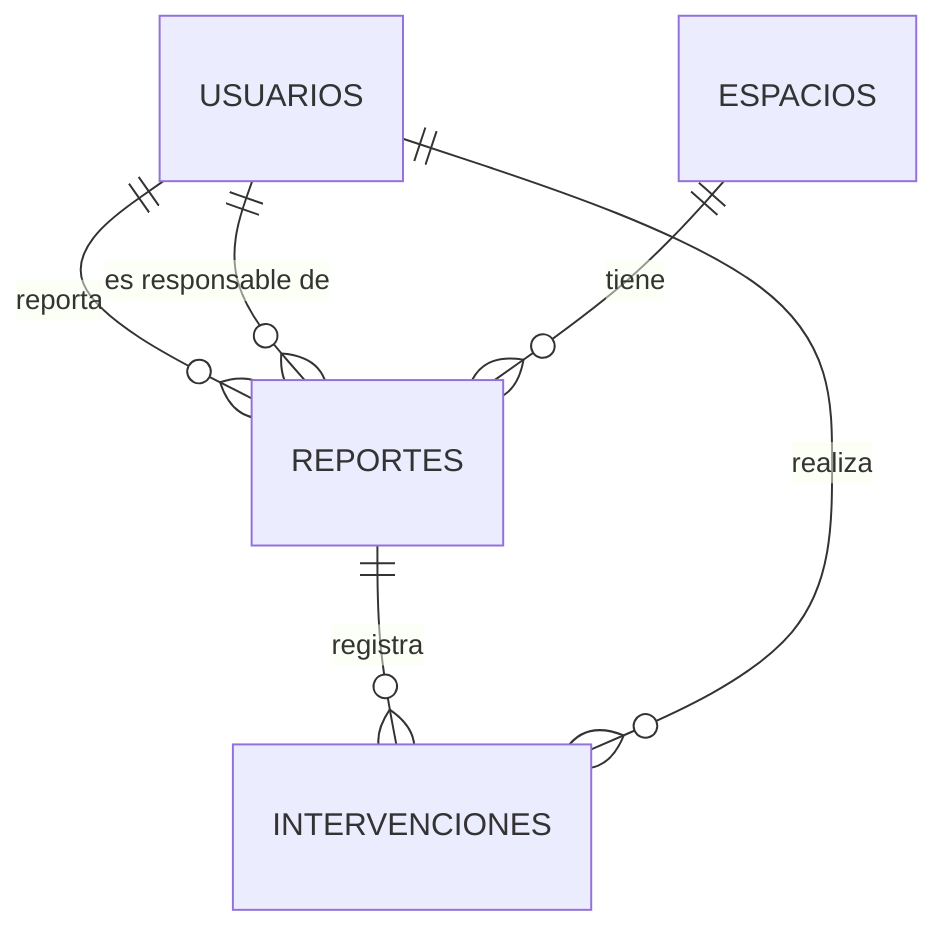
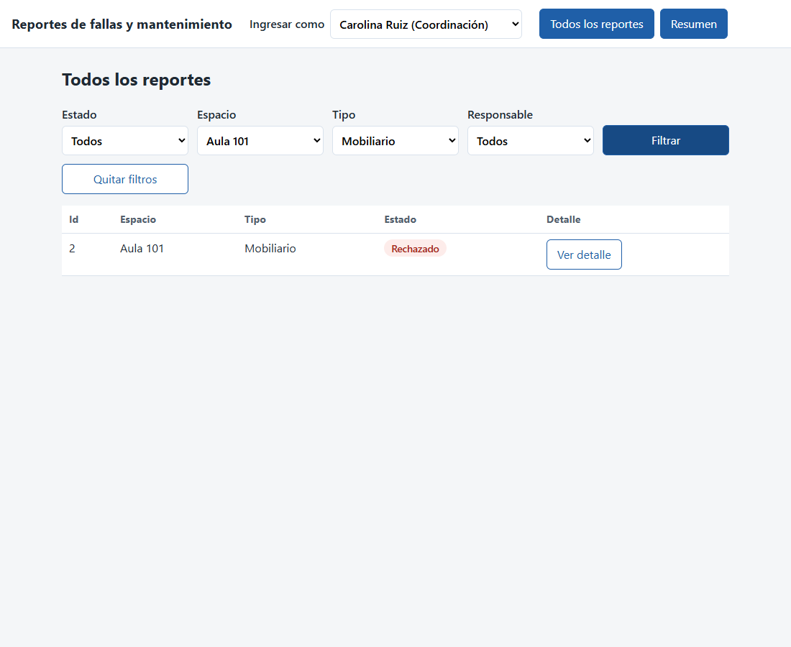
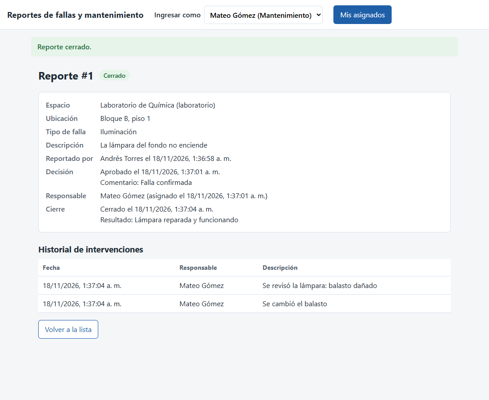

# Sistema de reportes de fallas y mantenimiento de instalaciones

Aplicación web para registrar fallas en los espacios de una organización y seguir su atención, desde el reporte hasta la evaluación, la asignación, las intervenciones y el cierre. Integra una interfaz web, una API REST y una base de datos relacional.

## 1. Información general

| Campo | Valor |
|---|---|
| Proyecto | Sistema de reportes de fallas y mantenimiento de instalaciones |
| Problema seleccionado | Gestión de mantenimiento de instalaciones (guía PF-05) |
| Asignatura | Aplicaciones y Servicios Web, Tecnología en Desarrollo de Software |
| Fecha de entrega | 18/11/2026 |
| Repositorio | https://github.com/edwinestebana-dev/Taller_Final-Servicios_Web |

**Integrante y contribución**

| Integrante | Usuario de GitHub | Contribución |
|---|---|---|
| Edwin Esteban Arias Escobar | `edwinestebana-dev` | Integrante único. Requisitos, diseño, backend (API REST, reglas de negocio y persistencia), frontend, pruebas funcionales y documentación. |

## 2. Descripción del sistema

**Problema.** Las fallas de las instalaciones (aulas, oficinas, laboratorios y zonas comunes) se informaban por llamadas, correos y mensajes, sin un registro común. Así era difícil saber qué casos seguían pendientes, quién debía atenderlos y qué se había hecho.

**Actores.**

| Actor | Qué hace en el sistema |
|---|---|
| Reportante | Registra fallas y consulta sus propios reportes. |
| Personal de mantenimiento | Consulta los reportes que tiene asignados, registra intervenciones y los cierra. |
| Coordinación | Ve todos los reportes, los evalúa (aprueba o rechaza), asigna responsables y consulta el resumen. |

**Alcance.** Registro de fallas asociadas a un espacio, evaluación, asignación de un responsable, historial de intervenciones, cierre con resultado y consulta consolidada (conteo por estado y filtros). Los reportes no se eliminan.

**Resumen de la solución.** Una página web única en la que el usuario elige con quién ingresar («Ingresar como»). Ve un menú y unas acciones según su rol. La página llama a una API REST hecha con FastAPI, que valida los datos, aplica los permisos y las transiciones de estado y guarda todo en SQLite.

**Restricciones.**
- No hay inicio de sesión con contraseña: el usuario se elige de una lista de usuarios ficticios y el servidor toma su rol de la base de datos.
- Los espacios y usuarios vienen precargados y no tienen pantallas de administración.
- No se implementan fotos, notificaciones, exportación, búsqueda por texto, paginación, prioridad, reasignación ni reapertura.

Detalle completo en [docs/requisitos.md](docs/requisitos.md).

## 3. Requisitos y alcance

**Método utilizado.** Se pidió una entrevista al docente, en su papel de representante de la organización, pero no hubo respuesta. Por eso el equipo tomó las decisiones necesarias, eligiendo la opción más sencilla que cumple CA-01 a CA-06. Quedaron registradas como **supuestos no confirmados** el 17/11/2026: [requisitos.md, sección 1](docs/requisitos.md#1-registro-de-entrevista-y-decisiones) y [sección 8](docs/requisitos.md#8-supuestos-no-confirmados).

**Evidencia de entrevista y decisiones confirmadas.** No hay entrevista realizada ni decisiones confirmadas por el docente. La aprobación sigue pendiente ([requisitos.md, sección 9](docs/requisitos.md#9-aprobación-del-docente)). Los supuestos de mayor impacto son:
- **S-01:** identificar al usuario con una lista, sin contraseñas.
- **S-02:** el responsable asignado es quien cierra el reporte.
- **S-03:** los reportes repetidos se rechazan con motivo.
- **S-04:** el historial exigido es el de intervenciones.
- **S-05:** espacios y usuarios precargados.

**Requisitos priorizados.** Todos son prioritarios y cubren CA-01 a CA-06:

| Requisito | Descripción |
|---|---|
| RF-01, RF-02 | Registrar un reporte asociado a un espacio; consultar los espacios. |
| RF-03, RF-04 | Listar los reportes según el rol; ver el detalle de un reporte. |
| RF-05, RF-06 | Evaluar (aprobar o rechazar con motivo); asignar un responsable. |
| RF-07, RF-08 | Registrar intervenciones; ver el historial en orden cronológico. |
| RF-09, RF-10 | Cerrar con resultado; consultar el cierre. |
| RF-11, RF-12 | Conteo por estado; filtros por estado, espacio, tipo y responsable. |
| RF-13, RF-14 | Identificar al usuario y su rol; interfaz web por rol. |
| RNF-01 a RNF-07 | Validación en el servidor, permisos en cada endpoint, base relacional con restricciones, códigos HTTP adecuados, sin secretos, README reproducible e integración real. |

**Historias de usuario y criterios de aceptación.**

| Historia | Condición | Criterio principal |
|---|---|---|
| HU-01: registrar una falla | CA-01 | Un reporte válido queda `reportado`; uno sin espacio, tipo o descripción se rechaza. |
| HU-02: aprobar o rechazar | CA-02 | El rechazo exige motivo; solo coordinación evalúa. |
| HU-03: asignar responsable | CA-03 | Solo reportes aprobados y solo a personal de mantenimiento. |
| HU-04: registrar intervenciones | CA-04 | Solo el responsable asignado; quedan en el historial. |
| HU-05: cerrar con resultado | CA-05 | Exige intervenciones y resultado; después no se modifica. |
| HU-06: consolidado | CA-06 | Conteos por estado coherentes y filtros por estado, espacio, tipo y responsable. |

**Ciclo de estados:**



## 4. Arquitectura, diseño de API y modelo de datos



El backend también sirve los archivos del frontend: todo se ejecuta con un solo comando y no hay problemas de CORS.

**Componentes y responsabilidades.**

| Componente | Responsabilidad |
|---|---|
| [backend/app/main.py](backend/app/main.py) | Crea la aplicación y las tablas, registra los routers, da formato a los errores 422 y sirve el frontend. |
| [backend/app/routers/](backend/app/routers/) | Reciben cada solicitud HTTP y devuelven la respuesta (`usuarios`, `espacios`, `reportes`). |
| [backend/app/security.py](backend/app/security.py) | Identifica al usuario con el encabezado `X-Usuario-Id` y verifica su rol. |
| [backend/app/services.py](backend/app/services.py) | Reglas de negocio: visibilidad por rol, transiciones de estado y permisos sobre cada reporte. |
| [backend/app/schemas.py](backend/app/schemas.py) | Validación del formato de entradas y salidas (Pydantic). |
| [backend/app/models.py](backend/app/models.py) | Tablas, claves foráneas y restricciones (SQLAlchemy). |
| [backend/app/database.py](backend/app/database.py) | Conexión a SQLite (con claves foráneas activadas) y sesión por solicitud. |
| [backend/app/seed.py](backend/app/seed.py) | Carga de usuarios y espacios ficticios. |
| [frontend/js/api.js](frontend/js/api.js) | Una llamada `fetch` por endpoint. |
| [frontend/js/app.js](frontend/js/app.js) | Pantallas por rol y eventos. |

**Modelo de datos.**



- **usuarios:** `id`, `nombre`, `rol` (solo `reportante`, `mantenimiento`, `coordinacion`).
- **espacios:** `id`, `nombre` (único), `tipo`, `ubicacion`.
- **reportes:**
  - `id`, `espacio_id` (FK), `reportante_id` (FK), `tipo_falla` (lista fija), `descripcion` (no vacía), `estado` (lista fija) y `fecha_creacion`;
  - campos de evaluación: `comentario_decision` (obligatorio si se rechaza) y `fecha_evaluacion`;
  - campos de asignación: `responsable_id` (FK) y `fecha_asignacion`;
  - campos de cierre: `resultado_cierre` y `fecha_cierre`.
- **intervenciones:** `id`, `reporte_id` (FK), `responsable_id` (FK), `descripcion` (no vacía), `fecha`.

**Capturas de la interfaz.** Las 11 capturas del recorrido completo están en [docs/diseno.md, sección 5](docs/diseno.md#5-recorridos-de-los-actores-y-prototipos) y en [docs/prototipos/](docs/prototipos/). Algunas:





**Tecnologías y justificación.**

| Componente | Tecnología | Justificación |
|---|---|---|
| Frontend | HTML, CSS y JavaScript sin framework | Sencillo, sin compilación y suficiente para las pantallas requeridas. |
| Backend | Python con FastAPI y Pydantic | Visto en clase. Valida con Pydantic y genera la documentación interactiva en `/docs`, que sirve para las pruebas. |
| Persistencia | SQLite con SQLAlchemy | No requiere instalar un servidor y admite claves foráneas y restricciones. |

Diseño completo, especificación de la API y decisiones técnicas: [docs/diseno.md](docs/diseno.md).

## 5. Configuración del entorno

**Requisitos de software:**
- Python 3.14 (probado con 3.14.7).
- Git.
- Un navegador web.

Las dependencias, con versiones fijas, están en [backend/requirements.txt](backend/requirements.txt): `fastapi`, `uvicorn[standard]`, `sqlalchemy`, `pydantic` y `python-dotenv`.

**Instalación** (Windows, PowerShell):

```powershell
git clone https://github.com/edwinestebana-dev/Taller_Final-Servicios_Web.git
cd Taller_Final-Servicios_Web

py -m venv .venv
.\.venv\Scripts\Activate.ps1
# Si PowerShell bloquea la activación:  Set-ExecutionPolicy -Scope Process Bypass

pip install -r backend\requirements.txt
```

En Linux o macOS se crea el entorno con `python3 -m venv .venv` y se activa con `source .venv/bin/activate`.

**Variables de entorno.** El archivo [.env.example](.env.example) no contiene secretos: SQLite es un archivo local y no usa usuario ni contraseña. Es opcional copiarlo como `.env`; sin él se usa el mismo valor por defecto. El archivo `.env` está excluido de Git.

```powershell
Copy-Item .env.example .env
```

| Variable | Valor por defecto | Uso |
|---|---|---|
| `DATABASE_URL` | `sqlite:///./reportes.db` | Ruta de la base de datos, relativa a la carpeta `backend/`. |

**Preparar la base de datos y ejecutar.** Todos los comandos se ejecutan desde `backend/`:

```powershell
cd backend
python -m app.seed              # crea las tablas y carga los datos ficticios
uvicorn app.main:app --reload   # arranca la API y sirve el frontend
```

- Al cargar los datos debe aparecer `Datos cargados: 5 usuarios y 6 espacios.` Si se ejecuta otra vez, no duplica datos.
- La interfaz web queda en http://127.0.0.1:8000/
- La documentación interactiva de la API queda en http://127.0.0.1:8000/docs

Para volver a una base limpia: detener el servidor, borrar `backend/reportes.db` y ejecutar de nuevo `python -m app.seed`.

**Datos de prueba ficticios** (los crea [seed.py](backend/app/seed.py)):

| Id | Usuario | Rol |
|---|---|---|
| 1 | Carolina Ruiz | coordinacion |
| 2 | Mateo Gómez | mantenimiento |
| 3 | Laura Pérez | mantenimiento |
| 4 | Andrés Torres | reportante |
| 5 | Sofía Ramírez | reportante |

Espacios:
1. Aula 101
2. Aula 204
3. Laboratorio de Química
4. Sala de Cómputo 3
5. Oficina de Coordinación
6. Cafetería Central

## 6. Servicios web implementados

**Identificación.** Cada solicitud envía el encabezado `X-Usuario-Id` con el id del usuario. El servidor toma el rol de la base de datos. `GET /usuarios` es el único endpoint público.

| Método | Ruta | Descripción | Roles | Éxito | Requisito relacionado |
|---|---|---|---|---|---|
| GET | `/usuarios` | Lista de usuarios para «Ingresar como» | Público | 200 | RF-13 |
| GET | `/espacios` | Lista de espacios | Todos | 200 | RF-02 |
| POST | `/reportes` | Registra una falla | Reportante | 201 | RF-01 |
| GET | `/reportes` | Lista según el rol; filtros `estado`, `espacio_id`, `tipo_falla`, `responsable_id` | Todos | 200 | RF-03, RF-12 |
| GET | `/reportes/resumen` | Conteo de reportes por estado | Coordinación | 200 | RF-11 |
| GET | `/reportes/{id}` | Detalle con espacio, decisión, responsable, intervenciones y cierre | Según visibilidad | 200 | RF-04, RF-08, RF-10 |
| PATCH | `/reportes/{id}/evaluacion` | Aprueba o rechaza | Coordinación | 200 | RF-05 |
| PATCH | `/reportes/{id}/asignacion` | Asigna responsable | Coordinación | 200 | RF-06 |
| POST | `/reportes/{id}/intervenciones` | Registra una intervención | Responsable asignado | 201 | RF-07 |
| PATCH | `/reportes/{id}/cierre` | Cierra con resultado | Responsable asignado | 200 | RF-09 |

**Códigos de error.** Todos usan el formato `{"detail": "mensaje"}`, sin datos sensibles:

| Código | Cuándo |
|---|---|
| 401 | Falta el encabezado `X-Usuario-Id` o el usuario no existe. |
| 403 | El rol no tiene permiso, o el usuario no es el responsable asignado del reporte. |
| 404 | El reporte no existe o el usuario no puede verlo. |
| 409 | Transición de estado no permitida. |
| 422 | Datos faltantes o inválidos. |

**Ejemplos.**

`POST /reportes` con `X-Usuario-Id: 4`:

```json
{ "espacio_id": 3, "tipo_falla": "iluminacion", "descripcion": "La lámpara del fondo no enciende" }
```

Respuesta `201`:

```json
{
  "id": 1, "espacio_id": 3, "tipo_falla": "iluminacion",
  "descripcion": "La lámpara del fondo no enciende",
  "estado": "reportado", "fecha_creacion": "2026-11-18T10:30:00.123456"
}
```

`PATCH /reportes/1/evaluacion` con `X-Usuario-Id: 1`:

```json
{ "decision": "aprobar", "comentario": "Falla confirmada" }
```

Respuesta `200`: el detalle del reporte con `"estado": "aprobado"`.

Errores reales de la API:

| Solicitud | Respuesta |
|---|---|
| `POST /reportes` con `{"espacio_id": 3, "tipo_falla": "agua", "descripcion": "x"}` | `422` `{"detail": "Datos inválidos: el campo 'tipo_falla' debe ser uno de: 'iluminacion', 'mobiliario', 'climatizacion', 'otro'"}` |
| `PATCH /reportes/2/evaluacion` con `{"decision": "rechazar"}` | `422` `{"detail": "El rechazo requiere un comentario con el motivo"}` |
| `PATCH /reportes/2/asignacion` sobre un reporte rechazado | `409` `{"detail": "No se puede asignar un reporte que no está aprobado"}` |
| `POST /reportes/1/intervenciones` por un usuario de mantenimiento no asignado | `403` `{"detail": "Solo el responsable asignado puede realizar esta acción"}` |
| `GET /reportes/999` | `404` `{"detail": "Reporte no encontrado"}` |
| `GET /reportes` sin encabezado | `401` `{"detail": "Debe identificarse con un usuario válido"}` |

**Documentación de la API:**
- Interactiva: http://127.0.0.1:8000/docs, con el servidor en marcha.
- Especificación: [docs/diseno.md, sección 3](docs/diseno.md#3-especificación-de-la-api-rest).

## 7. Pruebas de API e integración y evidencias de funcionamiento

Las 12 pruebas funcionales mínimas de la guía están en [docs/pruebas.md](docs/pruebas.md). Cada una incluye requisito, condiciones iniciales, pasos, datos de entrada, método y código HTTP, resultado esperado, resultado obtenido, estado y evidencia. No se usan pruebas automatizadas.

| Id | Prueba | Requisitos | Estado |
|---|---|---|---|
| P-01 | Registro de un reporte válido | RF-01, RF-02 | Ver [Aprobada](docs/pruebas.md#p-01) |
| P-02 | Registro con datos faltantes o inválidos | RF-01, RNF-01 | Ver [Aprobada](docs/pruebas.md#p-02) |
| P-03 | Consulta de reportes y detalle | RF-03, RF-04 | Ver [Aprobada](docs/pruebas.md#p-03) |
| P-04 | Consulta de un reporte inexistente | RF-04, RNF-04 | Ver [Aprobada](docs/pruebas.md#p-04) |
| P-05 | Evaluación válida | RF-05 | Ver [Aprobada](docs/pruebas.md#p-05) |
| P-06 | Transición de estado no permitida | RF-05, RF-06 | Ver [Aprobada](docs/pruebas.md#p-06) |
| P-07 | Asignación de un responsable autorizado | RF-06 | Ver [Aprobada](docs/pruebas.md#p-07) |
| P-08 | Gestión por un usuario no autorizado | RF-13, RNF-02 | Ver [Aprobada](docs/pruebas.md#p-08) |
| P-09 | Registro de una intervención válida | RF-07, RF-08 | Ver [Aprobada](docs/pruebas.md#p-09) |
| P-10 | Cierre y consulta de su resultado | RF-09, RF-10 | Ver [Aprobada](docs/pruebas.md#p-10) |
| P-11 | Consulta de información consolidada | RF-11, RF-12 | Ver [Aprobada](docs/pruebas.md#p-11) |
| P-12 | Integración interfaz–API–base de datos | RF-14, RNF-07 | Ver [Aprobada](docs/pruebas.md#p-12) |

**Cómo reproducirlas:**
1. Preparar una base limpia: borrar `backend/reportes.db`, ejecutar `python -m app.seed` y arrancar el servidor.
2. Ejecutar P-01 a P-11 en orden desde http://127.0.0.1:8000/docs. En cada endpoint: **Try it out**, escribir el id en `X-Usuario-Id`, pegar el cuerpo y pulsar **Execute**.
3. Ejecutar P-12 desde la interfaz, en http://127.0.0.1:8000/

El detalle de cada paso está en [docs/pruebas.md, sección "Preparación"](docs/pruebas.md#preparación).

**Evidencias:**
- Las de cada prueba se guardan en [evidencias/](evidencias/) con el nombre de la prueba (por ejemplo `evidencias/P-01.png`).
- Las capturas del proceso completo (reporte, rechazo, asignación, intervenciones, cierre y resumen) y de los casos inválidos en la interfaz están en [docs/prototipos/](docs/prototipos/).

**Matriz de trazabilidad:** [docs/trazabilidad.md](docs/trazabilidad.md).

## 8. Control de versiones

**Repositorio:** https://github.com/edwinestebana-dev/Taller_Final-Servicios_Web

**Forma de trabajo:**
- Cada paso se desarrolló en su propia rama, con commits descriptivos en español.
- Los cambios se integraron a `main` mediante pull requests. Cada PR documenta su propósito, los cambios, las pruebas efectuadas y los requisitos asociados.
- Los dos primeros commits (creación del repositorio y documentos de requisitos y diseño) se hicieron directamente en `main`, antes de adoptar el trabajo por ramas.

| Pull request | Rama | Contenido |
|---|---|---|
| [#1](https://github.com/edwinestebana-dev/Taller_Final-Servicios_Web/pull/1) | `feature/estructura-y-modelos` | Estructura del proyecto, `.gitignore`, `.env.example`, dependencias, modelos con restricciones y `seed.py`. |
| [#2](https://github.com/edwinestebana-dev/Taller_Final-Servicios_Web/pull/2) | `feature/consulta-y-registro-reportes` | Identificación por `X-Usuario-Id`, `GET /usuarios`, `GET /espacios`, `POST /reportes`, `GET /reportes` con filtros y visibilidad, y `GET /reportes/{id}`. |
| [#3](https://github.com/edwinestebana-dev/Taller_Final-Servicios_Web/pull/3) | `feature/evaluacion-asignacion-y-cierre` | Evaluación, asignación, intervenciones, cierre, resumen y transiciones de estado. |
| [#4](https://github.com/edwinestebana-dev/Taller_Final-Servicios_Web/pull/4) | `docs/capturas-y-ajustes-diseno` | Capturas de la interfaz y ajustes del diseño. |
| [#5](https://github.com/edwinestebana-dev/Taller_Final-Servicios_Web/pull/5) | `feature/frontend-por-rol` | Interfaz web por rol, servida por el backend. |
| [#7] | `docs/pruebas-trazabilidad-readme` | Pruebas funcionales, matriz de trazabilidad y este README. |

**Aportes.**
- El proyecto tiene un único integrante (`edwinestebana-dev`), autor de todos los commits y pull requests. Se pueden revisar en el [historial de commits](https://github.com/edwinestebana-dev/Taller_Final-Servicios_Web/commits/main) y en los [pull requests](https://github.com/edwinestebana-dev/Taller_Final-Servicios_Web/pulls?q=is%3Apr).
- Al ser una sola persona, no hay revisiones de código entre integrantes.

## 9. Conclusiones y limitaciones

**Cumplimiento.**
- La aplicación implementa el proceso completo exigido: registro de fallas asociadas a un espacio (CA-01), evaluación (CA-02), asignación (CA-03), intervenciones con historial (CA-04), cierre con resultado (CA-05) y consulta consolidada (CA-06).
- Interfaz, API y base de datos se comunican de verdad, sin datos simulados.
- Durante el desarrollo se verificaron el flujo completo y los casos de error de cada endpoint. La ejecución formal de las 12 pruebas queda registrada en [docs/pruebas.md](docs/pruebas.md).
- La correspondencia entre condiciones, requisitos, componentes y pruebas está en [docs/trazabilidad.md](docs/trazabilidad.md).

**Dificultades técnicas y soluciones aplicadas.**
- **SQLite no valida las claves foráneas por defecto.** Se activan en cada conexión con `PRAGMA foreign_keys = ON` ([database.py](backend/app/database.py)).
- **`/reportes/resumen` podía confundirse con `/reportes/{id}`.** La ruta del resumen se declara antes ([routers/reportes.py](backend/app/routers/reportes.py)).
- **FastAPI responde los errores de validación como una lista en inglés.** Un manejador propio los convierte al formato `{"detail": "mensaje"}` en español ([main.py](backend/app/main.py)).
- **Orden de las verificaciones.** Para que los códigos sigan el orden de la tabla de reglas del diseño, las reglas que dependen del estado se revisan en `services.py` y no solo con Pydantic. Por ejemplo, cerrar un reporte que no está en atención responde 409 aunque falte el resultado.
- **Compatibilidad con Python 3.14.** Se fijaron versiones recientes de las dependencias en `requirements.txt`.

**Limitaciones dentro del alcance aprobado.**
- **Identificación sin contraseña** (supuesto S-01). Cualquier cliente puede enviar el `X-Usuario-Id` de otro usuario. Es suficiente para demostrar los permisos por rol, pero no protege una instalación real.
- **Supuestos sin confirmar.** Las decisiones de requisitos siguen siendo supuestos del equipo hasta que el docente las revise.
- **Funciones fuera del alcance.** No hay reasignación ni reapertura: `rechazado` y `cerrado` son estados finales. Tampoco hay pantallas para administrar espacios ni usuarios.
- **Respuesta 403 en intervenciones y cierre.** Cuando un usuario de mantenimiento intenta actuar sobre un reporte que no le fue asignado, recibe 403, como indica la tabla de reglas del diseño. Esa respuesta le permite saber que el reporte existe, mientras que la consulta del detalle responde 404.
- **Base de datos local.** SQLite es un archivo local, pensado para ejecutar la aplicación en un solo equipo.
