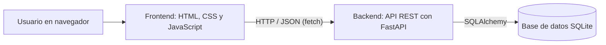
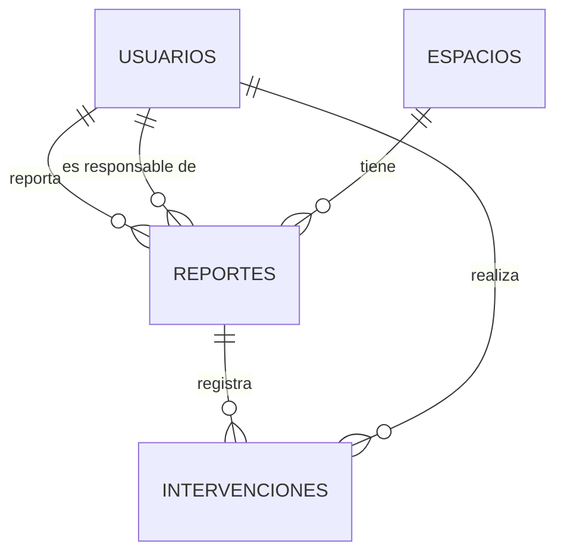
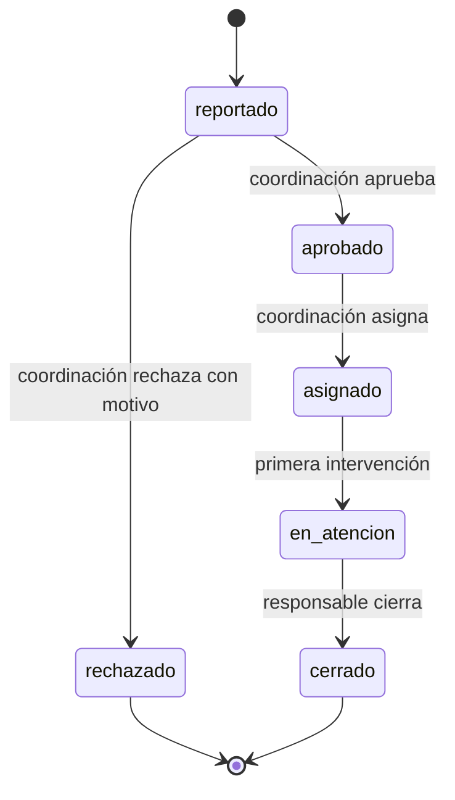

# Diseño: Sistema de reportes de fallas y mantenimiento de instalaciones

> Basado en `docs/requisitos.md` (borrador del equipo, supuestos pendientes de confirmación del docente).

## 1. Arquitectura y tecnologías



| Componente | Tecnología | Responsabilidad | Justificación |
|------------|-----------|-----------------|---------------|
| Frontend | HTML, CSS y JavaScript sin framework | Mostrar datos, capturar acciones, mostrar errores | Sencillo, sin compilación, suficiente para las pantallas requeridas |
| Backend | Python con FastAPI y Pydantic | Exponer la API REST, validar, aplicar reglas y permisos | Visto en clase; valida con Pydantic y trae documentación interactiva en `/docs`, que sirve como herramienta de pruebas |
| Persistencia | SQLite con SQLAlchemy | Guardar usuarios, espacios, reportes e intervenciones | No requiere instalar servidor; admite claves foráneas y restricciones |

El backend también sirve los archivos del frontend, así que todo se ejecuta con un solo comando y no hay problemas de CORS.

### Organización del código

```
backend/
  app/
    main.py          # crea la app, registra routers y sirve el frontend
    database.py      # conexión y sesión de base de datos
    models.py        # tablas (SQLAlchemy)
    schemas.py       # validación de entradas y salidas (Pydantic)
    security.py      # identifica al usuario y verifica roles
    services.py      # reglas de negocio y transiciones de estado
    routers/
      usuarios.py
      espacios.py
      reportes.py
    seed.py          # datos ficticios iniciales
  requirements.txt
frontend/
  index.html
  css/estilos.css
  js/api.js          # llamadas a la API
  js/app.js          # pantallas y eventos
docs/
evidencias/
```

Cada capa tiene una sola responsabilidad: los routers reciben y responden, `services.py` decide si una acción está permitida, `models.py` define los datos y `schemas.py` valida el formato.

## 2. Modelo de datos



**usuarios**

| Campo | Tipo | Restricciones |
|-------|------|---------------|
| id | entero | PK |
| nombre | texto | obligatorio |
| rol | texto | obligatorio; solo `reportante`, `mantenimiento`, `coordinacion` |

**espacios**

| Campo | Tipo | Restricciones |
|-------|------|---------------|
| id | entero | PK |
| nombre | texto | obligatorio, único |
| tipo | texto | obligatorio (aula, oficina, laboratorio, zona común) |
| ubicacion | texto | obligatorio (edificio y piso) |

**reportes**

| Campo | Tipo | Restricciones |
|-------|------|---------------|
| id | entero | PK |
| espacio_id | entero | FK a espacios, obligatorio |
| reportante_id | entero | FK a usuarios, obligatorio |
| tipo_falla | texto | obligatorio; `iluminacion`, `mobiliario`, `climatizacion`, `otro` |
| descripcion | texto | obligatorio, no vacío |
| estado | texto | obligatorio; `reportado`, `aprobado`, `rechazado`, `asignado`, `en_atencion`, `cerrado` |
| fecha_creacion | fecha y hora | automática |
| comentario_decision | texto | obligatorio si se rechaza |
| fecha_evaluacion | fecha y hora | se llena al evaluar |
| responsable_id | entero | FK a usuarios, se llena al asignar |
| fecha_asignacion | fecha y hora | se llena al asignar |
| resultado_cierre | texto | se llena al cerrar |
| fecha_cierre | fecha y hora | se llena al cerrar |

**intervenciones**

| Campo | Tipo | Restricciones |
|-------|------|---------------|
| id | entero | PK |
| reporte_id | entero | FK a reportes, obligatorio |
| responsable_id | entero | FK a usuarios, obligatorio |
| descripcion | texto | obligatorio, no vacío |
| fecha | fecha y hora | automática |

No hay borrado de reportes (RN-08). El historial de intervenciones sale de la tabla `intervenciones`, ordenada por fecha.

## 3. Especificación de la API REST

**Identificación del usuario:** cada solicitud envía el encabezado `X-Usuario-Id` con el id del usuario elegido. El servidor busca al usuario y toma su rol de la base de datos. Sin encabezado o con un id inexistente responde 401.

**Formato de errores:** `{"detail": "mensaje claro sin datos sensibles"}`.

| Código | Cuándo |
|--------|--------|
| 200 | Consulta o actualización correcta |
| 201 | Recurso creado |
| 401 | Falta identificar al usuario o el usuario no existe |
| 403 | El rol o el usuario no tiene permiso para la acción |
| 404 | El recurso no existe, o el usuario no puede verlo |
| 409 | Transición de estado no permitida |
| 422 | Datos faltantes o inválidos |

### Endpoints

| Método | Ruta | Descripción | Roles | Éxito | Errores | Requisito |
|--------|------|-------------|-------|-------|---------|-----------|
| GET | /usuarios | Lista de usuarios para elegir con quién entrar | Público | 200 | — | RF-13 |
| GET | /espacios | Lista de espacios | Todos | 200 | 401 | RF-02 |
| POST | /reportes | Registra una falla | Reportante | 201 | 401, 403, 422 | RF-01 |
| GET | /reportes | Lista según el rol; filtros `estado`, `espacio_id`, `tipo_falla`, `responsable_id` | Todos | 200 | 401, 422 | RF-03, RF-12 |
| GET | /reportes/resumen | Conteo de reportes por estado | Coordinación | 200 | 401, 403 | RF-11 |
| GET | /reportes/{id} | Detalle con espacio, decisión, responsable, intervenciones y cierre | Según visibilidad | 200 | 401, 404 | RF-04, RF-08, RF-10 |
| PATCH | /reportes/{id}/evaluacion | Aprueba o rechaza | Coordinación | 200 | 401, 403, 404, 409, 422 | RF-05 |
| PATCH | /reportes/{id}/asignacion | Asigna responsable | Coordinación | 200 | 401, 403, 404, 409, 422 | RF-06 |
| POST | /reportes/{id}/intervenciones | Registra una intervención | Responsable asignado | 201 | 401, 403, 404, 409, 422 | RF-07 |
| PATCH | /reportes/{id}/cierre | Cierra con resultado | Responsable asignado | 200 | 401, 403, 404, 409, 422 | RF-09 |

`/reportes/resumen` se declara antes que `/reportes/{id}` para que no se confunda "resumen" con un id.

### Ejemplos de solicitud y respuesta

**POST /reportes** (como reportante)

```json
{ "espacio_id": 3, "tipo_falla": "iluminacion", "descripcion": "La lámpara del fondo no enciende" }
```

Respuesta 201:

```json
{
  "id": 12, "espacio_id": 3, "tipo_falla": "iluminacion",
  "descripcion": "La lámpara del fondo no enciende",
  "estado": "reportado", "fecha_creacion": "2026-11-17T10:30:00"
}
```

**PATCH /reportes/12/evaluacion** (como coordinación)

```json
{ "decision": "aprobar", "comentario": "Falla confirmada" }
```

`decision` solo admite `aprobar` o `rechazar`; con `rechazar`, `comentario` es obligatorio.

**PATCH /reportes/12/asignacion**

```json
{ "responsable_id": 5 }
```

**POST /reportes/12/intervenciones**

```json
{ "descripcion": "Se cambió el balasto de la lámpara" }
```

**PATCH /reportes/12/cierre**

```json
{ "resultado": "Lámpara reparada y funcionando" }
```

**Ejemplo de error 409:**

```json
{ "detail": "No se puede asignar un reporte que no está aprobado" }
```

**GET /reportes/resumen** respuesta:

```json
{ "reportado": 3, "aprobado": 2, "rechazado": 1, "asignado": 2, "en_atencion": 1, "cerrado": 4 }
```

## 4. Reglas de negocio y control de acceso

Los routers solo reciben la solicitud; las decisiones están en `services.py` y los roles se verifican con `security.py`, de modo que se aplican aunque la solicitud no venga de la interfaz.

| Acción | Quién | Verificaciones (en orden) |
|--------|-------|---------------------------|
| Crear reporte | Reportante | Rol; espacio existe; tipo válido; descripción no vacía |
| Evaluar | Coordinación | Rol; reporte existe; estado `reportado` (si no, 409); rechazo con comentario |
| Asignar | Coordinación | Rol; reporte existe; estado `aprobado` (si no, 409); el responsable existe y tiene rol `mantenimiento` |
| Registrar intervención | Responsable asignado | Rol; es el responsable de ese reporte (si no, 403); estado `asignado` o `en_atencion` (si no, 409); si estaba `asignado`, pasa a `en_atencion` |
| Cerrar | Responsable asignado | Rol; es el responsable de ese reporte; estado `en_atencion` (si no, 409); resultado no vacío |
| Resumen | Coordinación | Rol |
| Listar y ver detalle | Todos | Reportante solo los suyos; mantenimiento solo los asignados; coordinación todos. Un reporte no visible responde 404 |

Transiciones permitidas (las demás devuelven 409):



## 5. Recorridos de los actores y prototipos

Es una sola página con un selector "Ingresar como" en la parte superior; el menú cambia según el rol.

| Actor | Pantallas | Recorrido principal |
|-------|-----------|---------------------|
| Reportante | Nuevo reporte; Mis reportes; Detalle | Elige espacio y tipo, escribe la descripción, envía; luego consulta el estado en "Mis reportes" |
| Coordinación | Todos los reportes (con filtros); Detalle con acciones; Resumen | Filtra por estado Reportado, abre el detalle, aprueba o rechaza; en uno aprobado, elige responsable y asigna; consulta el resumen |
| Mantenimiento | Mis asignados; Detalle con acciones | Abre un reporte asignado, registra intervenciones y, cuando termina, escribe el resultado y cierra |

Esquema de las pantallas clave:

```
[Ingresar como: (lista de usuarios)]            [Menú del rol]

Lista de reportes
+----+-----------+--------------+-------------+---------+
| Id | Espacio   | Tipo         | Estado      | Detalle |
+----+-----------+--------------+-------------+---------+
Filtros: [Estado] [Espacio] [Tipo] [Responsable]   (solo coordinación)

Detalle de reporte
Espacio, tipo, descripción, estado, fecha
Decisión / comentario | Responsable | Cierre y resultado
Historial de intervenciones (fecha, responsable, descripción)
Acciones según rol y estado:  [Aprobar] [Rechazar] [Asignar] [Registrar intervención] [Cerrar]
```

> Pendiente: insertar aquí las capturas del prototipo (Figma) o de la interfaz terminada, guardadas en `docs/prototipos/`.

## 6. Correspondencia entre requisitos y diseño

| Requisito | Componente de diseño |
|-----------|----------------------|
| RF-01, RF-02 | POST /reportes, GET /espacios; pantalla Nuevo reporte |
| RF-03, RF-12 | GET /reportes con filtros; pantallas de listado |
| RF-04, RF-08, RF-10 | GET /reportes/{id}; pantalla Detalle |
| RF-05 | PATCH /reportes/{id}/evaluacion |
| RF-06 | PATCH /reportes/{id}/asignacion |
| RF-07 | POST /reportes/{id}/intervenciones |
| RF-09 | PATCH /reportes/{id}/cierre |
| RF-11 | GET /reportes/resumen; pantalla Resumen |
| RF-13 | GET /usuarios y encabezado `X-Usuario-Id`; selector "Ingresar como" |
| RF-14 | Frontend por rol |
| RNF-01 | Esquemas Pydantic y validaciones en `services.py` |
| RNF-02 | `security.py` en cada endpoint |
| RNF-03 | `models.py` con claves foráneas y restricciones |
| RNF-04 | Códigos HTTP de la sección 3 y formato de error |
| RNF-05, RNF-06 | `.env.example`, `seed.py` con datos ficticios, README |
| RNF-07 | El frontend consume la API con `fetch` y no usa datos simulados |

## 7. Decisiones técnicas

- **Sin contraseñas:** el usuario se elige de una lista y el servidor toma el rol de la base de datos. Cumple la restricción de permisos sin añadir autenticación fuera del alcance.
- **Sin DELETE:** conserva la trazabilidad del proceso.
- **PATCH por acción** (evaluación, asignación, cierre): cada transición tiene su propio endpoint, lo que hace explícitas las reglas y simplifica las pruebas.
- **"En atención" automático:** evita un endpoint extra; el estado cambia con la primera intervención.
- **SQLite:** reduce la configuración; el modelo sería el mismo en un gestor con servidor.
